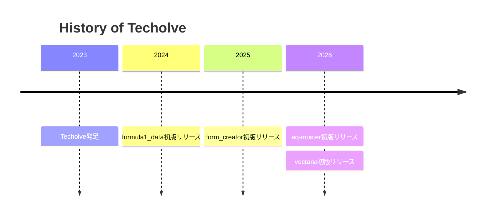

  

  
  

## 💡 About

**Techolve** は Tech + Evolve の造語から作成。「技術で進化する」意味を持つ。

**Techolve** is a coined word from *Tech* + *Evolve* — meaning "evolving through technology."

## 🚀 Projects

  
  
  
  
  
  

## 🗓️ Timeline

## 🧠 Tech Stack

